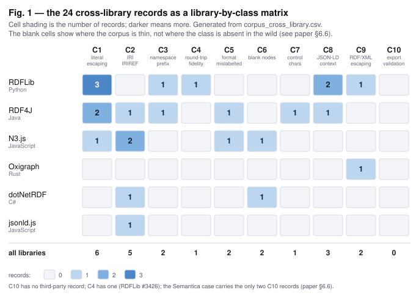

# Silent corruption at the export boundary

**A cross-library corpus and a ten-class typology of RDF export defects**

Qian Zhang (Independent researcher)

Preprint · 2026-10-12

---

## Abstract

Export is the last step of a knowledge-graph pipeline before its output leaves the process, and it fails quietly: the pipeline reports success, the file parses, and the graph is wrong in a way that surfaces only downstream. We screen seven general-purpose RDF and JSON-LD libraries across five languages and assemble 24 defect records from six of them, each anchored to a public issue, reproduced where possible. Three were closed by maintainers without a fix and one is flagged as possibly outside the inclusion rule, so the corpus is reported three ways: 24, a headline of 21, and a conservative 20. The author's own project is excluded from every count and reported as a case study.

From the corpus we derive a ten-class typology with operational criteria, on two axes (what is wrong, and at which write point) over three tiers: output the parser rejects, output that is well-formed but mislabelled, and output that opens an injection surface. Writers emit output their own parsers reject, in one case across a version boundary we located by running both versions. Malformed output can leave the process with a success status. And de-biasing the pool empties one defect class entirely, a property of the pool, not the world.

We then test the checks a library plausibly already has against the five records we could bring into a defective state locally. Our checks catch four of the five; a second implementation catches none the first missed, and the only record no check catches is the one whose admission is under review. That moves the design: a round-trip check against the library's own in-memory graph cannot see drift introduced while reading, so a further layer compares it against the source artefact. The limits are plain: 13 of the 24 records were run locally, 11 are labelled not run, four did not reproduce, and no second annotator has been used yet. The corpus, protocol and scripts are public.

**Keywords:** RDF serialisation, knowledge-graph pipelines, export correctness, defect corpus, round-trip fidelity, empirical software engineering

---

## 1 Introduction

### 1.1 The problem

A knowledge-graph pipeline ends by writing a file. Everything the pipeline decided is compressed into that file, and everything downstream — retrieval, audit, compliance review — is built on it. The writing step is unglamorous, heavily reused, and widely assumed to be correct, which is exactly the combination that lets defects persist.

Three failure modes motivate this study, all of them from real reports rather than constructed examples:

- A serialiser interpolates a string literal without escaping it. A single quotation mark inside a label produces output that no conforming Turtle parser will accept. (Semantica issue #1098, fixed in PR #1148.)
- A writer receives an entity identifier and writes it between angle brackets without validating it as an IRI. The output is invalid, and the same unchecked path is what injection attacks travel along. (Semantica issue #1099.)
- A writer is asked for one serialisation and emits another. The output parses and is **valid** RDF, in a format that was not requested, so it denotes something other than what the caller asked for. (N3.js issue #165: N-Triples requested, N-Quads emitted; its maintainer closed it without a fix, and §4.4 sets out why it stays in the corpus and out of the headline.)

The third case is the one that shapes this paper. A defect that produces invalid output is embarrassing but self-announcing: the next parser in the chain fails loudly. A defect that produces valid output that means, or is labelled, something other than what was asked is invisible to every check that only asks "does this parse?".

### 1.2 What we do

We treat export correctness as an object of study in its own right. We screen the trackers of seven general-purpose RDF and JSON-LD libraries with a fixed keyword set, read every candidate in full, and admit a record only if it documents a defective *output* — not a crash, not a performance complaint, not a memory-safety report. The result is a corpus of 24 records across five languages. We then ask what the corpus supports, and we are explicit about what it does not.

### 1.3 Contributions

1. **A screening protocol** written so that a second person can reproduce the selection, not only the counts, including the decision log for every candidate that was rejected (§3).
2. **A cross-library corpus** of 24 defect records from six of the seven screened libraries, across 5 languages, each with a public URL, a class label, a reproduction status and the trigger that produces it; **21** is the headline after the records their maintainers closed without a fix are removed, and one further record is flagged as possibly outside the inclusion rule, so the most conservative reading of the same corpus is 20 (§4).
3. **A ten-class typology** with operational criteria, laid out on two axes rather than as ten siblings, over three consequence tiers (§5).
4. **Empirical observations** that we did not expect, including self-rejection within a single library, success-coded malformed output, and the effect of de-biasing the pool on class coverage (§6).
5. **Three design guidelines** for exporter implementations, each traced back to a root cause visible in more than one library (§7).
6. **A measured baseline plus a three-layer check design** (conformance, fidelity against the in-memory graph, fidelity against the source artefact), with the baseline run on every record the local toolchains could bring into a defective state, and an explicit statement of what remains unrun (§9).

### 1.4 What this paper does not claim

We make no priority claim. The same territory is being worked on concurrently (§2.6), and the honest description of our contribution is breadth with published provenance, not first arrival. We do not claim that the counts are complete: the screening is keyword-seeded, so the numbers are a floor. We do not claim that the class distribution of the corpus is the class distribution of the world; §6.6 shows how little it takes to move that distribution. We do not claim that the baseline measurement generalises: it covers five records, and that is stated wherever it is used.

### 1.5 Status of every claim

A reader should be able to see which parts of this paper rest on measurement and which do not, without having to infer it from what is missing.

| Claim | Status |
|---|---|
| 24 records from six of the seven screened libraries, across 5 languages, each anchored to a public issue and URL | Complete; released as CSV |
| A recorded trigger for every record | **Partial**: five records carry the construction that reproduces them, and four others carry a `reproduced` verdict with no recorded construction (flagged in `notes`); of the remaining fifteen, four were executed only on a version where the defect no longer triggers and eleven were not executed at all. That is a gap in the corpus, not only in this paper (§9.3) |
| Ten-class typology with written operational criteria, arranged on two axes | Complete; inter-annotator agreement **not run** |
| Runtime reproduction of individual records | **Partial**: 13 of 24 executed (Python, JavaScript), of which one was executed for this revision and twelve are carried from an earlier pass whose scripts are not part of this release (§4.3); 11 labelled `not run` (ten for lack of a JVM, Cargo or .NET SDK, one predating the runnable line) |
| Baseline: how much of the corpus existing checks already catch | **Run, 5 records**: four caught by at least one candidate gate, one caught by none (§9.3). The remaining records are unmeasured: their toolchains are absent, or the construction that reproduces them was not recorded |
| Fidelity harness implementation and recall figures | **Not run** |
| Complete bibliographic verification of cited work | **Updated**: every work cited in §2 carries an entry in References, each checked against a primary source (publisher DOI, arXiv record, or W3C page; for the two technical reports, the author's own publication page) |

---

## 2 Background and related work

### 2.1 Where export defects live

RDF serialisation formats constrain what a writer may emit. An IRI inside `<...>` may not contain certain characters; a string literal must escape the delimiters of the format that carries it; a prefixed name has its own lexical rules and a prefix mapping that must actually be in scope; a blank node has scoped identity that must survive the trip out. JSON-LD moves part of the meaning into a context object, so a writer can be syntactically impeccable and still produce a graph that differs from the one it was given.

The relevant property for this paper is the asymmetry between two ways of being wrong. Illegal output is caught by any conforming parser. Legal-but-different output is caught by nothing that only checks well-formedness; it requires comparing the exported graph against the graph that was meant.

### 2.2 Parsing-side repair

Repairing RDF that has already been written is an established line of work. RDF Doctor (KEOD 2019) addresses malformed RDF on the reading side. It is complementary to this study and does not overlap with it: a repair tool accepts the defect as given, while we are concerned with why the defect was written in the first place and with the writers that produce them.

### 2.3 Shape validation

SHACL constrains the shape of a graph, not the fidelity of a serialisation. A writer that drops a datatype, mints an entity into the wrong namespace, or renames a prefix can produce a graph that passes the same shape validation as the correct one, because the shape language describes the intended data and not the act of writing it. Our case study contains a record where a shape never matched the data it was written for, precisely because the generator and the exporter disagreed about a namespace (Semantica issue #1104).

### 2.4 Conformance suites and graph comparison

The W3C test suites for the RDF syntaxes describe conformance per format and per specification revision, and the tightening of IRI rules in RDF 1.2 is directly relevant to the class of defect we label C2. The JSON-LD 1.1 test suite plays the same role for JSON-LD, exercising expansion, compaction and the context handling that C8 is about. These suites test implementations against a specification. They are not product-level benchmarks: they do not take a pipeline's actual output, and they do not ask whether the output means what the pipeline intended.

Comparing two graphs rather than testing one against a specification is a different problem, and it is the one the fidelity layers of §9 have to solve. Deciding whether an export recovered its input means deciding graph isomorphism, and the community has standardised a canonical form for that: RDF Dataset Canonicalization (RDFC-1.0) maps a dataset to a canonical N-Quads form and describes the earlier URDNA2015 algorithm as essentially the same thing. The labelling algorithms behind both are set out by Hogan (2017), who also gives canonical forms for equivalent graphs, not only isomorphic ones. Isomorphism is not known to have a polynomial-time decision procedure in general, so a round-trip gate of the kind G3 proposes is a practical design rather than a free one: affordable on the small adversarial inputs §7.3 lists, and not something to run unconditionally over arbitrary graphs.

### 2.5 Differential testing of RDF stores

Randomised differential testing has been applied to RDF stores, comparing the answers of multiple engines to the same query in order to expose logic defects (RD2, ICSE 2023). The technique is established and predates this work; what we borrow is the idea that disagreement between independent implementations is evidence, and what we move is that technique to the writing side rather than to query answering — here as a design with a first measurement (§9.3) rather than as a finished differential tester, which §9.2 records as not yet run.

### 2.6 Concurrent work on the same seam

A cross-library study of semantic-integrity defects in knowledge-graph pipelines has been published as a technical report on the author's site, keeping the libraries anonymous, reporting four defects across four libraries together with a tool baseline in which a large static-analysis rule set and a reference shape validator missed all of them (Rovai, technical report, publication status not established at the time of writing). A companion report applies the same method to a single pipeline, Semantica, and reports seventeen defects there. Those seventeen are that report's own screening and are not the eleven records of our case study (§8): we re-screen the case against §3.1 and anchor every record to a public issue, so the two sets overlap only in part and none of the figures in this paper rests on the other's count.

We treat this work as the closest prior work and build on its method rather than beside it. It is a technical report on the author's own site rather than a peer-reviewed publication, and the reference records that; it is treated as the closest prior work because it asks the same question about the same seam across several libraries, which no published paper we found does at this revision. The differences are deliberate and are stated here rather than left for a reviewer to find: we name the libraries, so that every record can be traced to a public issue and re-run by its maintainers; we cover more libraries and more languages; and we publish the screening protocol together with the corpus. Whether naming the libraries is the better choice is an open question and the trade is discussed in §10.

Adjacent work includes evidence-carrying validation for knowledge graphs (Fierro, arXiv:2608.15948), which argues that a validator should return the evidence behind a verdict rather than a boolean; an ontology engineering engine used as an independent verifier in the concurrent work above (Open Ontologies, arXiv:2605.09184); and the standing literature on RDF and SPARQL injection (Asghar et al., 2016), which is where the injection-surface tier of our typology connects.

### 2.7 The gap we are addressing

We are not aware of a published corpus of export defects that simultaneously (a) names the libraries, (b) anchors every record to a public issue, (c) publishes the screening protocol including rejections, and (d) reports which records were actually executed. That combination is what this paper contributes. A systematic search to confirm or refute this statement is a prerequisite for submission and is listed as pending.

---

## 3 Screening protocol

This section is written so that a second person can reproduce the selection, not only the counts. It is released together with the corpus.

### 3.1 Unit of analysis

The unit is a **defect record**, anchored to a public issue or pull request in a public tracker. A record is admitted only if it documents that a serialiser or exporter wrote output that is one of:

- **not well-formed** for the format it declared; or
- well-formed but **semantically mislabelled** (wrong namespace, wrong datatype, or a format different from the one requested); or
- **lossy on round-trip**, meaning a re-parse does not recover the input graph; or
- accompanied by an **export-time failure that passed silently**.

A defect whose effect is confined to the read side is out of scope. What the four bullet points above ask is whether the **written output** is wrong, not where in the pipeline the wrongness entered: a defect whose mechanism sits on the read side but whose effect is visible in the written output — a value rewritten as the source is read, so that the export disagrees with its input — is in scope, and RDFLib #3426 (§6.4, §9.3) is admitted on that reading. A defect that shows itself only in what the reader accepts or rejects leaves the written output correct and is out of scope, which is why the four withdrawn records of §4.4 do not qualify. The formats in scope are the RDF and JSON-LD serialisation syntaxes and the SPARQL result-set formats (TSV, CSV): both are produced by an exporter at the same boundary, so a record about a result-set writer is admitted on the same terms as one about a graph serialiser (RDF4J #747 and #6084 are the two here). Data formats such as GraphML, Parquet or Arrow are outside that boundary and out of scope for the main table.

### 3.2 Library pool

A library enters the pool if it is a general-purpose RDF or JSON-LD processor, has had merged activity within the last three years, and is a distinct implementation rather than a wrapper. Language coverage is deliberately spread so that a claim about a class of defect does not rest on one ecosystem's idioms.

Pool (7): RDFLib (Python), N3.js (JavaScript), jsonld.js (JavaScript), Apache Jena (Java), RDF4J (Java), Oxigraph (Rust), dotNetRDF (C#).

The first author's own project, Semantica, is **excluded from all cross-library statistics** and reported separately as a case study (§8), because mixing it in would let a large share of the main table be self-reported.

### 3.3 Search

For each pool library the tracker is searched with a fixed keyword set: `serialize`, `serializer`, `serialization`, `serialisation`, `escaping`, `namespace`, `prefix`, `turtle`, `n-triples`, `n-quads`, `json-ld`, `round-trip`, `writer`, `export`. Both spellings of *serialis- / serializ-ation* are listed because trackers match literally: searching the largest pool library for one spelling returns 36 hits against 194 for the other (measured 2026-10-10), so screening with a single spelling would have under-counted the other systematically. The set is weighted toward format words, so some classes are reached only indirectly — C2, C6 and C8 are carried in by `turtle`, `writer` or `json-ld` rather than by a class-specific word, and their recall is uneven.

Hits are then read in full and passed through §3.1 and §3.4 by hand. **A keyword hit is a candidate, never a sample; nothing enters the corpus on a title alone.** §6.7 reports what that rule costs in practice.

### 3.4 Inclusion and exclusion

Exclude when any of the following holds:

- the output is valid for the declared format and semantically identical, and the complaint is about verbosity or compaction quality;
- the report is a feature request rather than a defect;
- the maintainers have re-classified it as a non-defect, on the ground that the output is correct;
- the defect concerns memory safety or the security of the processing path rather than the correctness of the written output;
- no concrete defective output is shown.

A maintainer statement decides a record only when it is a statement about the output. Where a maintainer closes a report on the ground that the fix belongs elsewhere in the stack, the record stays in the corpus and the maintainer's position is recorded in `fix_evidence`: such a closure says where the validation belongs, not that the recorded output is right. The two N3.js records closed on those grounds in October 2026 are named in §4.4, next to the exclusions that do rest on a claim about the output. Where a maintainer reads a record as a specification question without asserting that the recorded output is correct, the record also stays in the corpus but is kept out of the headline; that third case is RDF4J #5521, and §4.4 records the reading.

Where a maintainer closes a report without a fix and without asserting that the output is correct, the record stays in the corpus but is kept out of the headline; where a record's admission is itself under review it is carried with a separate flag. The front-line counts are computed three ways, not twice: the full corpus, the corpus with the maintainer-closed records removed, and the corpus with both the maintainer-closed and the flagged records removed.

### 3.5 Recording schema

One row per defect: `library`, `language`, `issue`, `url`, `year`, `class`, `one_line`, `state`, `fix_evidence`, `runtime_repro`, `trigger`, `notes`. The class label uses the taxonomy of §5. `runtime_repro` records what was actually executed and on which version. A fix commit or a maintainer statement counts as `fix_evidence` but is not a substitute for `runtime_repro`. `trigger` is the construction that produces the defective output — the minimum code, input and version needed for someone else to see the defect. It is a required column, and §9.3 explains why: a `reproduced` verdict without a recorded trigger is not checkable, and four records in this corpus (#166, #660, #3373, #3279) were carried that way.

---

## 4 The corpus

### 4.1 Counts

| Quantity | Value |
|---|---|
| Records screened and admitted, cross-library | 24 |
| Headline (maintainer-closed records removed) | **21** |
| Most conservative reading (maintainer-closed and flagged records removed) | **20** |
| Libraries screened | 7 |
| Libraries with at least one admitted record | 6 |
| Languages | 5 (Python, JavaScript, Java, Rust, C#) |
| Records with a runtime reproduction | 13 |
| Records carrying the trigger that reproduces them | 5 (§9.3) |
| Records labelled `not run` (ten for lack of a JVM, Cargo or .NET SDK, one predating the runnable line) | 11 |
| Records withdrawn after re-reading (read-side defects, released separately) | 4 |
| Candidates excluded on reading (released separately) | 8 |
| Candidates rejected on manual reading, latest screening round | 7 of 17 |
| Separate case-study records (excluded from all figures above) | 11 |

Three records sit outside the headline because their maintainers closed them without a fix: RDF4J #5521, labelled `wontfix/specification`, and N3.js #659 and #165, both closed in October 2026. RDFLib #3443 is the flagged record. Following §3.4, all three figures are given wherever the headline is quoted, and §4.4 records the ground for each.

Two rows in this table have different denominators and should not be read as a pair. "24" is the cumulative corpus; "7 of 17" describes only the candidates surfaced by the keyword search in the latest screening round — ten were admitted and seven rejected on reading, and one of the ten (Oxigraph #1345) was moved to the excluded list on a second reading (§4.4). The 17 are not a subset of the 24. §6.7 is where that ratio is used.

### 4.2 Composition

| Library | Language | Records | Years |
|---|---|---|---|
| RDFLib | Python | 8 | 2021–2026 |
| RDF4J | Java | 7 | 2017–2026 |
| N3.js | JavaScript | 5 | 2019–2026 |
| Oxigraph | Rust | 1 | 2026 |
| dotNetRDF | C# | 2 | 2017, 2026 |
| jsonld.js | JavaScript | 1 | 2017 |
| **Total** | **5 languages** | **24** | |

Apache Jena was screened and carries no admitted record at this revision: the two candidates it supplied turned out to be read-side conformance items and sit in `withdrawn_records.csv` (§4.4). Six of the seven pool libraries therefore contribute records, and the blank cells of Figure 1 are where the pool is thin rather than where the class is absent from the world.

| Class | Meaning | Records |
|---|---|---|
| C1 | literal escaping and token boundaries | 6 |
| C2 | IRI / IRIREF | 5 |
| C3 | namespace and prefix handling | 2 |
| C4 | round-trip fidelity | 1 |
| C5 | format mislabelling | 2 |
| C6 | blank nodes | 2 |
| C7 | control characters and Unicode | 1 |
| C8 | JSON-LD context and compaction | 3 |
| C9 | RDF/XML escaping | 2 |
| C10 | export-time validation | **0** |

The full table with issue numbers, URLs and reproduction status is Appendix A and is released as `corpus_cross_library.csv`. Figure 1 shows the same data as a library-by-class matrix; the blank cells are where the corpus is thin, and §6.6 explains why a thin cell is not evidence that the class is rare in the wild.

### 4.3 Reproduction status by language

| Language | Records | Executed locally | Basis |
|---|---|---|---|
| Python | 8 | 8 | RDFLib 7.6.0 and 6.0.0 / 6.3.2 |
| JavaScript | 6 | 5 | N3.js 2.7.2; jsonld.js record predates the runnable line |
| Java | 7 | 0 | `not run`, no JVM |
| Rust | 1 | 0 | `not run`, no Cargo |
| C# | 2 | 0 | `not run`, no .NET SDK |

The table counts what was executed, not what is still broken: four of the thirteen ran on a version where the defect no longer triggers, and those are counted as executed runs rather than as tracker citations.

One executed record and one side probe are worth separating from the rest. The executed record located a version boundary: RDFLib #1395 emits a prefixed name its own parser rejects on 6.0.0 and escapes it correctly from 6.3.2 onward, so the defect is provably live on one released version and provably fixed on another. The side probe is jsonld.js #584, a prototype-pollution path still live in jsonld 9.0.0; it concerns the security of the processing path rather than the correctness of the written output, so it sits outside the corpus and is recorded here as a note rather than as a record.

The other twelve executed records were run on 2026-09-02, in a prior revision of this corpus, and are carried over with the version information in their `runtime_repro` column. Their scripts are not part of this release; of the thirteen executions, only the RDFLib #1395 run above was performed for this revision, the jsonld.js #584 probe being outside the corpus. A reader re-running the release therefore reproduces one of the thirteen executions directly and has to reconstruct the other twelve from the protocol's provenance note and the earlier report. Separately from that count, the 2026-10-10 measurement (§9.3) re-executed eight of the twelve inherited records (four in the gate measurement, four in the re-test), and those runs confirmed or failed to confirm the recorded behaviour without producing a new `runtime_repro` verdict; the count of thirteen executions and its provenance are unchanged. The JavaScript records are pinned at `n3@2.7.2` (2026-09-01); a cross-version check against the current release, `n3@2.13.12` (2026-10-10), is recorded in `corpus/baseline/BASELINE.md` and confirms that the two JavaScript writer defects are still written, and still rejected by the writer's own parser, on `latest`.

### 4.4 Withdrawals, exclusions and maintainer closures

Four records that had been admitted in an earlier revision are withdrawn in this one, after re-reading each issue against §3.1. All four are defects whose effect is confined to the read side: the written output is correct, and only the acceptance or repair of the input is at issue. §3.1 admits a record when the **written output** is defective, which is why a defect whose mechanism is on the read side but whose effect reaches the output (RDFLib #3426, §6.4) stays in while these four do not:

- **N3.js #578.** The StreamParser throws when a language tag is split across two HTTP response chunks; parsing the same bytes as a single string works. The failure is in consuming the input, not in producing it.
- **Apache Jena #2766.** The `turtle` command warns about illegal characters while *parsing* a legal UTF-8 IRI. The failure is on the read side, and the class label the record carried (C5, format mislabelling) does not fit the issue text either.
- **Apache Jena #3281 and #3931.** Both ask the parsers to reject surrogate code points written as `\u` or `\U` escapes, which RDF 1.2 forbids. The follow-up states the position in its own text: Jena has accepted such escapes and has *not written* them. The constraint is on what the parser accepts, not on what the writer emits, so neither record documents a defective output.

All four are kept in `withdrawn_records.csv` rather than deleted: a record can describe a real defect and still not be an export defect. Recording the withdrawal is what lets a reader see the criterion applied to a record we had ourselves admitted, and not only to candidates we rejected on sight.

Eight candidates are excluded, and the reasons are part of the protocol rather than an appendix to it. Three deserve to be named, two of them having been carried as samples in an earlier revision of this corpus and withdrawn after reading the maintainer threads:

- **Oxigraph #1121.** The maintainers replied that the output is valid RDF/XML for the same graph and merely less pretty than the input. On that reading the record is not a correctness defect.
- **RDFLib #948.** The maintainers reclassified it as an enhancement: the output is valid Turtle, and only prefix shortening is missing.
- **Oxigraph #1345.** The serialiser picks a shorter matching prefix, so `myProperties:name` comes out as `myOntology:props\/name`. The two prefixes are nested, so the output resolves to the same IRI, `\/` is a legal local-name escape, and the complaint is only that the writer did not take the longest match. That is compaction, not a defective output, and the record is excluded on the same rule that removed the two above.

The judgement that removes records is the judgement a reviewer will apply to every record we admit, so it is published rather than summarised: `excluded_candidates.csv` carries the eight with their reasons.

The remaining five exclusions were verbosity or compaction quality (Oxigraph #993, dotNetRDF #10), a feature request (Oxigraph #1543), code hygiene with no concrete defective output (dotNetRDF #34), and a security-of-processing-path report (jsonld.js #584).

**Three records are kept out of the headline because their maintainers closed them without a fix.** Naming them is part of the same policy as naming the withdrawals, and the three do not share a single ground, so the grounds are separated here. **RDF4J #5521** is labelled `wontfix/specification` — the maintainers read the emitted compaction as correct under the specification, which is a reading of the specification rather than an assertion that nothing was lost. **N3.js #659 and #165** were both closed on 2026-10-03 with the written output left as it was, and each closure is a statement about where the validation belongs rather than about the output: on #659, that the terms should be validated before they reach the Writer; on #165, that the case "is handled outside the Writer (see #638)" — the fix pull request #638 was itself closed unmerged. Neither closure claims the recorded output is right, and neither denies the recorded behaviour: the unescaped IRI that breaks out of the angle brackets, and the N-Quads emitted in answer to a request for N-Triples. They stay in the corpus rather than moving to the excluded list because §3.4 admits an exclusion only where the maintainers' ground is that the output is correct, which is the ground on which #948 and #1121 were excluded; a dismissal that says where a fix belongs is a different act from one that says the output is fine. A reader who thinks a maintainer's dismissal should settle a record can delete the three rows from the released CSV and recompute every figure in §4 and §6; the headline and the most conservative reading in §4.1 are already computed that way.

One of the three carries a narrowed scope in this revision. **#659** originally recorded two components in one row, an unescaped IRI and unescaped control characters. The maintainer's closing note separates them. On the IRI half it says where the validation belongs, so that half stays admitted. On the control-character half it states that "literals with raw DEL/C1 characters are valid Turtle and N-Triples and round-trip correctly", which is a statement about the output and, under §3.4, takes that half out of scope. The record is therefore narrowed to the IRI half — the half §7.1 cites — and the control-character half is not admitted. The narrowing moves no count: the record was already outside the headline, and C2 is the class of the half that remains.

One further record is carried with a flag. **RDFLib #3443** concerns multiline literal escaping; the prior reproduction report judges the emitted output to be legal RDF and the report itself to be a request for a different escaping style rather than a defect. It is retained with an explicit flag in the `notes` column instead of being silently kept or silently dropped, because its admission decision has not been settled and a reader should be able to see that. Were it removed, the corpus would be 23 records with a headline of 20. We have not removed it in this revision and we do not read the difference as material to any claim, but a reader who disagrees with the admission can recompute every figure in §4 and §6 from the released CSV with one row deleted.

---

## 5 A typology of export defects

The ten classes were derived by clustering the corpus, not by partitioning a specification. Each class is stated as a criterion that a second person is meant to be able to apply without further discussion; whether they can is an empirical question that has not yet been tested (§10). The criteria were first stress-tested by an in-house blind pass over the corpus run on a language model, not on an independent human annotator; that pass prompted the boundary tightening below and is a methods check, not an agreement study.

An earlier presentation of this typology placed ten classes side by side. They are not ten of the same kind: some name a defect at the level of a character, some at the level of a term, one at the level of the format, and one — C10 — is not a defect in the output at all but a property of the code that wraps the others. Reading them as siblings implies that the axes have been mixed, and that implication is correct. The classes are therefore given two axes below. The identifiers C1–C10 are unchanged: §6, §9 and the released CSV refer to them, and stable labels are worth more than tidier numbering.

**Axis A — what is wrong with the output.** *characters*: the output is not legal for the format it declares. *term identity*: the output is legal and the term names something other than what was meant. *format identity*: the output is legal and is not the format requested or declared. *graph identity*: each term is individually fine and the graph as a whole is not the one that was written.

**Axis B — where in the write path the defect enters.** The literal write point, the IRI write point, the character encoder, the XML encoder, the prefix-binding step, the context emitter, the blank-node labeller, or the format selector.

| # | Class | Axis A — what is wrong | Axis B — where | Operational criterion | Consequence tier | Representative records |
|---|---|---|---|---|---|---|
| C1 | Literal escaping and token boundaries | characters | literal and term-separator write point | a lexical boundary is wrong: the emitted literal terminates early or carries a delimiter it should have escaped, a delimiter is escaped where the format does not require it so that the value changes on re-parse, two adjacent terms are emitted without the separator the format requires, or a token is split across a write boundary — so the output does not re-parse in the declared format, or does not re-parse to the same value | parser-reject | RDF4J #1815, N3.js #565, RDFLib #2767, RDFLib #1395 |
| C2 | IRI / IRIREF escaping | characters | IRI write point | an IRI written between `<...>` does not have the character restrictions of IRIREF applied to it. This covers the IRI inside the angle brackets only: escaping inside a prefixed name or a local name is a C1 boundary defect, not a C2 defect | parser-reject, injection surface | N3.js #659, RDF4J #1535, N3.js #166 |
| C3 | Namespace and prefix | term identity | prefix-binding step | a term is bound to a prefix or namespace other than the one it belongs to | mislabelling | RDFLib #3105, RDF4J #4929 |
| C4 | Round-trip fidelity | graph identity | cross-cutting | parse → serialise → parse does not recover the input graph, and the divergence cannot be attributed to a more specific class above; a divergence localisable to a named write point is classified there and not here | mislabelling | RDFLib #3426 |
| C5 | Format mislabelling | format identity | format selector | the format actually emitted differs from the one requested, or from the one named by the file | mislabelling | N3.js #165, RDF4J #6084 |
| C6 | Blank nodes | term identity | blank-node labeller | blank-node identity is split, merged or dropped on write, or a structural assertion carried only on a blank-node root is discarded by compression so the output graph is not isomorphic to the input | mislabelling | N3.js #660, dotNetRDF #903 |
| C7 | Control characters and Unicode | characters | character encoder | control characters, lone surrogates or DEL are written through, or the character encoder escapes Unicode in the opposite direction and escapes characters that need none | parser-reject, injection surface | RDF4J #1317 |
| C8 | JSON-LD context and compaction | term identity | context emitter | context or `@vocab` handling loses or invents type and namespace information | mislabelling | RDFLib #2812, RDFLib #3373 |
| C9 | RDF/XML escaping | characters | XML encoder | an attribute or element is emitted without XML escaping, so the document is not well-formed XML | parser-reject | Oxigraph #1859, RDFLib #3279 |

**C10 is a property, not a sibling.** C10 (export-time validation) is different in kind: "the failure is not reported" can be true of any cell in the table above, so it has no position on either axis. It is stated separately rather than as an eleventh row because its whole content is that one of the other classes was allowed to pass unnoticed. The cross-library corpus has no representative of C10 and the case study has two (§6.6); that is a fact about the pool, not about the class.

**One criterion is wider than its surviving representatives.** C7 covers both directions of character handling — control characters written through unchanged, and Unicode escaped where the format needs no escaping — but after the 2026-10-11 withdrawals the corpus holds only the second direction (RDF4J #1317). The first direction has no cross-library representative at this revision, and the criterion is left as written rather than narrowed to fit the rows that remain, so that a future record in either direction lands in the class without a re-definition. The same is true in the other direction of C4, which has a single representative (RDFLib #3426) and a criterion written to cover any divergence that cannot be localised to a more specific class.

### 5.1 Consequence tiers

- **Parser-reject.** The output is not legal for the format it claims. Downstream fails, loudly.
- **Mislabelling.** The output is legal and says something other than what was meant. Nothing downstream fails; the error is discovered, if at all, by a human who knows what the answer should have been. C3, C4, C5, C6 and C8 belong here, and C10 is the property that any of them may additionally have.
- **Injection surface.** The unchecked path that produces an illegal IRI is the same path an attacker uses to write content of their choosing into the output. We record this tier conservatively: it is an observation about the shape of the defect, not a demonstration of exploitability, which we have not attempted.

### 5.2 Why the tiers matter

The tiers predict which existing defence will catch a given defect, and §9.3 measures that prediction rather than asserting it. The short version: a conformance check catches the first tier and is blind to the second, which is why §9 proposes more than one layer rather than more rules in the first.

---

## 6 What the corpus shows

### 6.1 Syntax-level defects dominate the pool

C1, C2, C7 and C9 account for 14 of the 24 records (12 of 20 on the most conservative reading of §4.4). Escaping and IRI handling are the largest single theme, and they are old: the corpus contains records from 2017 and records from 2026 in the same classes. Whatever mechanism produces these defects is not being retired by time alone.

### 6.2 Writers emit output their own parsers reject

This is the observation with the starkest consequence in the corpus, and it is not an abstraction about interoperability between projects: the writer and the parser of the same project disagree about the format, so no second implementation is needed to expose it.

| Record | Library | What happens |
|---|---|---|
| #1395 | RDFLib | the Turtle serialiser writes `dbr:This_(journal)`; re-parsing with RDFLib's own parser raises `BadSyntax` on 6.0.0; from 6.3.2 the same input is written as `dbr:This_\(journal)` and round-trips |
| #1535 | RDF4J | the N-Triples/Turtle writer emits a `\"` inside an IRI; Rio, the project's own parser, then rejects the output (as recorded in the issue; the record was not run here, no JVM) |

The important word in both rows is "own". A project's writer and its parser are maintained by the same people and tested against each other, and in these two cases the contract between them was broken anyway. This also has a methodological consequence: a round-trip check that uses the writing library's own parser is not a weak approximation of an independent check, it is a check that would have caught two of the defects in this corpus.

### 6.3 Failure that reports success

| Record | Library | What happens |
|---|---|---|
| #1859 | Oxigraph | the RDF/XML serialiser emits malformed XML when a predicate has no QName local part, and the command still exits with a success status |

This record is what makes the case for treating export validation (C10) as its own class rather than as a sub-case of the others. The pipeline is not merely wrong, it is wrong in a way that its own control flow certifies as correct. It is also the only third-party record of the kind here: C10 has no other cross-library representative at this revision (§6.6), so the argument rests on one case, and §6.5 carries the format-mislabelling records that are often confused with it. RDF4J #6084 sits in §6.5, not here: its symptom is a value rewritten into a different lexical form, which is mislabelling rather than a swallowed failure.

### 6.4 Silent semantic drift on round-trip

RDFLib #3426 rewrites a `Z` timezone designator into `+00:00`. The value is unchanged; the lexical form is not, and any consumer that compares lexical forms — a diff, a hash, a signature — sees a different graph. RDF4J #4929 loses an explicit prefix between parse and serialise; it is labelled C3 because what is lost attaches to the prefix binding, and it is read here as a second instance of silent drift in the round-trip passage rather than as a naming failure, because nothing downstream fails on it. Neither produces an error anywhere.

### 6.5 Format mislabelling survives a conformance check

N3.js #165 requests N-Triples and receives N-Quads. Both are valid serialisations, so a check that asks "is this valid RDF?" answers yes; only a check that asks "is this the format that was requested?" answers no. The record is one of the three maintainer-closed records of §4.4 and is used here for the shape of the defect rather than as a count in the headline; the shape does not depend on the closure either way. RDF4J #6084 is the same shape one level down, at the level of the value rather than the syntax.

### 6.6 De-biasing the pool empties a class — a result about the pool, not about the world

The first author maintains Semantica, so it is excluded from the cross-library figures. That exclusion has a measurable cost, and the cost is the finding:

| Class | Cross-library (24 records) | Semantica case (11 records) |
|---|---|---|
| C10 export-time validation | **0** | 2 |
| C4 round-trip fidelity | 1 | 0 |
| all other classes | 23 | 9 |

C10 has no third-party representative at all at this revision; C4 has one. Any statement about the frequency of those two classes in the wild would therefore be an artefact of which libraries were screened. We report the histogram with this caveat attached rather than letting the shape of the table imply uniform coverage, and we note the general lesson: **in a small library pool, class coverage is a property of the pool.** A corpus like this one can support existence claims, and cannot support prevalence claims.

This is reported as a result rather than filed under limitations because it is a consequence of the screening design, not a hedge against it: the de-biasing step a reader would demand is the same step that empties the class, so anyone who wants the histogram without the caveat is asking for the un-de-biased one.

### 6.7 Keyword screening has a measurable error rate

Of the 17 candidates surfaced by the keyword search in the latest round, ten were admitted and seven were rejected on reading, two of them having previously been carried as samples; one of the ten admitted was moved to the excluded list on a second reading in the 2026-10-11 revision (#1345, §4.4), so nine of the seventeen are in the corpus. The value of publishing this number is that it converts a methodological caution ("a keyword hit is not a sample") into a quantity that a reader can use when assessing how complete the corpus is: the shortlist was 53% precise, and the corpus should be read as a floor.

---

## 7 Root causes and design guidelines

Three root causes account for eleven of the twenty-four records. Each is stated with the records that make it visible, and each yields a guideline that can be implemented in any RDF writer.

### 7.1 R1 — the IRI write point does not validate

Records: N3.js #659 (narrowed to its IRI half, §4.4) and #166, jsonld.js #206, dotNetRDF #70, RDF4J #1535, RDFLib #1395.

A writer receives a string that is supposed to be an IRI and writes it between angle brackets. Nothing between the string and the output enforces the character rules of the format. The consequence is illegal output (RDF4J #1535, where the project's own parser rejects it) and, in the same shape, the injection surface.

**Guideline G1.** *Validate at the write point.* IRI emission should pass through a single function that enforces IRIREF rules and either escapes, rejects or refuses the write. In the records we examined the change is local to the write point, and a small one; whether it closes the class in general is untested.

### 7.2 R2 — escaping logic is duplicated per path and per format

Records: N3.js #659 (the IRI half, §4.4), RDFLib #3443 (flagged, §4.4), RDF4J #1815, dotNetRDF #70.

Escaping tends to be re-implemented wherever a literal or an IRI is written, once per format and once per code path. Divergent copies drift: the same literal is escaped correctly on one path and not on another. Semantica's own history shows the fix being applied twice — a first repair to the export path (#1148) followed by a consolidation that merged the duplicate escapers (#1221).

**Guideline G2.** *One escape layer, one source of truth.* All formats should route through a single escaping implementation parameterised by format, so that a fix lands everywhere at once.

### 7.3 R3 — round-trip is not an enforced property

Records: RDFLib #1395, RDF4J #1535, RDFLib #3426, RDF4J #4929, dotNetRDF #903.

Nothing in the normal development loop asserts that what the writer produced can be read back into the graph it came from. Where a maintainer has stated the property, it has the character of an axiom rather than a test: on dotNetRDF #903 a maintainer confirmed the defect is reproducible on 3.x and opened a fix, with the remark that round-trip is what serialisation is supposed to provide.

**Guideline G3.** *Make round-trip a gate.* Parse → serialise → parse, compared for graph isomorphism, as a blocking check in CI, with a corpus of adversarial inputs (quotation marks, newlines, characters outside the BMP, IRIs with percent escapes or parentheses, timezones, blank-node collections). The comparison needs a canonical form rather than a pairwise search (§2.4), which is affordable on inputs of the size listed here and not on arbitrary graphs. The increment in this guideline is not the comparison itself — an independent engine can be asked for one, and the concurrent work does ask for one (§2.6) — but treating it as a blocking gate that a release has to pass, run over a fixed adversarial set rather than over whatever the project's existing tests happen to cover.

### 7.4 One further observation, about identity

RDFLib #3426 is worth separating out because it is not an escaping bug at all but a normalisation bug, and it is invisible to every check that compares values rather than lexical forms. A guideline that follows from it is that round-trip checks should compare graphs at the level of terms **and** their lexical forms, not only at the level of values.

---

## 8 Case study: Semantica

### 8.1 Why the case is reported separately

The first author maintains Semantica, one of the projects screened. Reporting its defects inside the cross-library counts would let self-reported records carry a large share of the main table, so the project is excluded from every figure in §4 and §6 and reported here instead.

### 8.2 The records

| Issue | Class | What was wrong | Fixed by |
|---|---|---|---|
| #1098 | C1 | `serialize_to_turtle` interpolated literals unescaped | PR #1148 (maintainer, first-party) |
| #1099 | C2 | entity id/type written raw inside `<>` with no IRI validation | PR #1112 (external contributor) |
| #1146 | C3 | `@vocab` minted entities and metadata into the shipped `ns#` | PR #1236 (maintainer, first-party) |
| #1104 | C3 | shape generator wrote under `/shapes`, the rest under `/ns#`, so shapes never matched the data | PR #1124 (external contributor) |
| #1108 | C10 | the method registry swallowed exceptions, so the gate could not refuse an export | PR #1127 (external contributor); independent-engine remedy added in PR #1166 |
| #874 | C10 | the distance exporter swallowed errors, making a failed metric indistinguishable from no path | PR #879 (external contributor) |
| #478 | C9 | the OWL exporter emitted invalid Turtle and silently dropped data properties | PR #479 (another maintainer) |
| #1097 | C5 | the conversion routine was never called, so every RDF path exported an empty literal | PR #1113 (external contributor) |
| #1699 | C5 | the export entry point ignored the file extension and aborted two formats on an empty collection | PR #1700 (maintainer, first-party) |
| #1712 | C5 | the CLI advertised fourteen export formats and six of them could not run | PR #1719 (maintainer, first-party) |
| #1788 | C3 | shape generation emitted a doubled `xsd:` prefix, producing an unparseable IRI that no constraint could match | PR #1792 (maintainer, first-party) |

### 8.3 What the case adds

Three things, none of which the cross-library counts can supply by themselves.

**C10 exists.** Both export-validation records in this study come from this project, and both were fixed. The cross-library corpus has no representative of the class at all (§6.6), so without the case the class would be a definition with no evidence behind it.

**Continuity over time.** The records span April to September 2026, and the first-party fixes are the most recent ones: #1700, #1719 and #1792 were merged in September, after the screening window of most published work on this seam. A defect class that keeps producing fixes in the current quarter is not a historical curiosity.

**The class is not a solo project.** Of the eleven records, six were fixed by other contributors rather than by this paper's author — five accounts, one of which is a maintainer of the project and another of which is the author of the closest prior work (§2.6), whose later pull request added an independent-engine verification step (PR #1166, on #1108). Independent-engine verification is not claimed here as a contribution of this paper: the concurrent work already applies it, and the step is recorded as part of the case's history rather than as a proposed guideline. What G3 proposes is narrower and does not depend on that step being novel — a round-trip comparison as a blocking gate over a fixed adversarial set (§7.3). A one-maintainer project would be a weak case; this one is a repository where an export defect, once reported, tends to attract a fix.

### 8.4 Non-claims for the case

The case demonstrates that these defects occur, are fixed, and are fixed by more than one person. It does not demonstrate that the fixes generalise, that the maintainer's own fixes are representative of anything, or that the project's defect rate is typical. In particular, the fact that the maintainer fixed five of the eleven records is not evidence about the difficulty of those defects; it is a statement about who was reading the tracker.

---

## 9 A three-layer check: design, baseline, and what has been run

### 9.1 Design

§5.2 predicts that one check cannot cover both tiers, so the design starts with two. §9.3 adds a third, and the measurement is what added it.

| Layer | Question it asks | Mechanism | Classes addressed |
|---|---|---|---|
| Conformance | is the output legal for the format it declares? | re-parse the output with a conforming parser for that format and require acceptance | C1, C2, C7, C9 |
| In-memory fidelity | does the output mean what the graph in memory meant? | parse the output, compare term-level against the graph as held in memory, literal lexical forms included | C5, C6, C8 |
| Source fidelity | does the output say what the input artefact said? | compare the output against the document that was read, literal lexical forms included | C3, C4 |

The first three compose into a single gate a project can run over its own exporter. The third layer exists because the second cannot see damage the library did while reading (§9.3). A fourth component sits outside these three and is not a comparison at all: a wrapper obligation on the calling code to return a non-success status whenever a lower layer fails. That is why C10 is a property rather than a class (§5). The three consequence tiers of §5.1 do not map one-to-one onto these layers: the injection-surface tier has no layer of its own, because an injection surface is a property of how an illegal IRI is written rather than a distinct failure a comparison can test, and where it is caught it is caught by the conformance layer as a by-product of rejecting the illegal IRI.

### 9.2 Status: what has been run and what has not

| Component | Status | Evidence |
|---|---|---|
| Conformance layer over the corpus | **run, 5 records** | §9.3; per-record verdicts in `baseline_gates.csv` |
| In-memory fidelity layer over the corpus | **run, applicable to 2** | §9.3 |
| Source-fidelity layer over the corpus | **run, applicable to 2** | §9.3 |
| Baseline on the remaining 19 records | **not run** | no JVM, Cargo or .NET SDK locally, and the records inherited from the 2026-09-02 pass were not recorded with the construction that reproduces them |
| The libraries' own CI test suites as a gate | **not run** | would require running each project's suite against the defective versions |
| The reference shape validator as a gate | **not run** | no record in the measured subset has a shape to validate against, so it would report `n/a` throughout |
| Individual record reproduction, Python and JavaScript | run | 13 records — 1 run for this revision, 12 inherited from the 2026-09-02 prior corpus; see §4.3 |
| Version-boundary reproduction (RDFLib #1395) | run | 6.0.0 fails to re-parse; 6.3.2 onward escapes correctly |
| Adversarial check on jsonld.js #584 | run, side finding | prototype pollution still present in jsonld 9.0.0 |

The reason for the split is not modesty: a reader should be able to see at a glance what has been run rather than infer it from the absence of a results table.

### 9.3 The baseline, measured

The question a reviewer asks first is whether the checks these libraries already have catch these defects. We cannot answer it for the whole corpus: eleven records need toolchains that are absent here, and the records inherited from the earlier pass were not recorded with the construction that reproduces them, so there is nothing to re-run. We can answer it for the five records we could bring into a defective state, and for those we measured five candidate gates rather than the test suites the projects ship — the writing library's own parser, a parser from an independent implementation, a term-level comparison against the graph in memory, a comparison of prefix bindings, and a lexical comparison against the source document. The binding comparison applies to C3 and C8 and found nothing in this subset.

| Record | Class | own parser | independent parser | in-memory fidelity | binding level | source fidelity |
|---|---|---|---|---|---|---|
| RDFLib #1395 | C1 | caught | caught | n/a | n/a | n/a |
| RDFLib #3443 ‡ | C1 | missed | missed | missed | missed | missed |
| RDFLib #3426 | C4 | missed | missed | missed | missed | **caught** |
| N3.js #659 † | C2 | caught | caught | n/a | n/a | n/a |
| N3.js #165 † | C5 | caught | caught | n/a | n/a | n/a |

† closed by its maintainer without a fix; ‡ flagged, admission under review (§4.4).

Four of the five are caught by at least one gate. Three observations come out of the table. All three are scoped to the five records and the two formats it covers, and none of them is a statement about the nineteen records the baseline did not reach. The three-way reading of §4.1 applies to this subset as well, because two of the five rows are maintainer-closed records (#659, #165) and a third carries the flag (#3443): the measurement covers five records in full, three once the maintainer-closed records are set aside, and two on the most conservative reading. The first two observations below hold on all three readings; the third is stated in a form that does not rest on the flagged row at all.

**The second engine buys nothing here.** The independent parser returned the same verdict as the writing library's own parser on all five records: it caught nothing that the first missed. This supports the weaker claim in §6.2 — that a round-trip check using the library's own parser would have caught some of these defects — and it argues against the stronger assumption, common in this area, that an independent implementation is needed to expose writer defects.

**The quiet tier is invisible from inside the object model.** In-memory fidelity caught nothing, and that is structural rather than incidental. RDFLib #3426 rewrites a `Z` timezone designator into `+00:00`, and the measurement located where: the rewrite happens when the source is read, not when the output is written. By the time an in-process check can compare graphs, the graph in memory already holds `+00:00` and therefore agrees with the output. Only the source-fidelity layer sees it. This is why §9.1 has three layers and not two: a check that compares the output against the library's own object model is checking the library against itself.

**The one record missed by everything is the one whose admission is unsettled, and for that reason it carries no finding.** RDFLib #3443 is the record of §4.4 whose inclusion we question: its output is legal RDF, and the issue asks for a different escaping style. It is also the only record no gate catches. A record whose status as a defect is not settled cannot support a conclusion about detection, so the concurrence is reported as an entry in the table and is not read as evidence that the gates are incomplete. Reading it the other way would be circular — the same reading that makes it a defect makes its non-detection a finding, and the reading that makes it a style request makes the non-detection expected.

The measurement has a second and less comfortable result. Four other records — RDFLib #3105, #3373 and #3279, and N3.js #660 — were re-tested and did not reproduce under the construction reconstructed for them, and the earlier pass recorded a verdict for them but no construction. A reader who tries to re-check those four cannot. One of the four has an independent explanation: the N3.js tracker records #660 as resolved in version 2.10.2, so a re-test that fails to reproduce carries the risk of running after the fix rather than falsifying the original verdict, and the version is recorded in that row's `fix_evidence`. The other three carry no such statement, `trigger` therefore becomes a required column of the corpus, and the four discrepancies are shipped as discrepancies to reconcile rather than as findings. The records whose `reproduced` verdict was recorded with no construction at all are a different, overlapping four — #166, #660, #3373, #3279 — flagged in §3.5. A corpus that cannot be re-run is not the artefact this paper claims to be publishing.

The concurrent work in §2.6 reports an instance of this measurement — a static-analysis rule set and a shape validator catching none of its four defects. That is a data point from another corpus and from a different gate family, and it does not substitute for the numbers above.

---

## 10 Threats to validity

**Construct validity — the taxonomy is ours.** The ten classes come from clustering this corpus, their criteria are stated so that a second person could apply them, and their arrangement on two axes is our reading of the corpus rather than a fact about it; no second person has yet applied either. An in-house blind pass run on a language model, not on a human annotator, was used to stress-test the criteria before this revision and found the C1/C2, C1/C7 and C4 boundaries fragile (§5); it is a methods check rather than an agreement study. Until an agreement study is run, the classes are a usable organisation of the corpus rather than a validated instrument. We expect the weakest boundaries to be between C3 and C8 (both term-identity defects at the binding and context steps) and between C2 and C7 (both character-level, at the IRI write point and the character encoder).

**Internal validity — the corpus did not record reproduction triggers.** A verdict of `reproduced` was recorded without the construction that produces the defect, which means the verdict cannot be re-checked. §9.3 records the four records that failed to reproduce under the construction we could reconstruct, and adds `trigger` as a required column. Four records is not a large discrepancy against twenty-four, but the failure mode is the one this paper is least entitled to have: an unreproducible artefact.

**Internal validity — the selection is keyword-seeded and single-screened.** Every record was read by one person against the criteria in §3. §6.7 quantifies how much of the shortlist is noise; it does not quantify what the keywords missed. A library whose defect reports happen to avoid the keyword set is under-represented, and the counts are a floor rather than a census.

**Internal validity — fix status is uneven.** Older records are mostly closed and newer ones mostly open, so a cross-library comparison of "still live" rates would compare discovery speed rather than defect density. We therefore do not compute one.

**Internal validity — attribution.** Fix attribution in the case study was checked against each issue's timeline on 2026-10-10, and two attributions carried in an earlier revision of the corpus were corrected as a result. The corrected file records that. Attribution errors are the kind of error that a maintainer reading this paper would notice first, which is why the check is documented rather than assumed.

**External validity — seven libraries, six of them contributing records, is a small pool.** §6.6 shows that removing one project from the pool empties an entire class, so prevalence statements are out of reach at this size. The corpus supports existence claims across five languages, which is what it is used for here.

**External validity — formats.** The corpus is grounded in Turtle, N-Triples, N-Quads, RDF/XML, JSON-LD and the tabular result formats. Other serialisation targets are not covered.

**External validity — naming the libraries.** Naming is a deliberate trade: it makes every record checkable by the maintainers who own it, and it puts a project's name next to a defect in print. The concurrent work in §2.6 took the other choice. We think the trade is worth making in exchange for verifiability, but the choice is a choice and is not neutral for the projects named.

**Conclusion validity — baseline numbers cover five records and no agreement figures exist.** §9.3 reports the baseline on the five records the local toolchains could bring into a defective state, so the numbers describe those five and nothing wider; the other nineteen are unmeasured, and the three observations drawn from the table inherit that scope. Two of the five sit outside the headline on the three-way reading of §4.1 and a third carries the flag, which §9.3 accounts for rather than leaving to the reader. No inter-annotator agreement study has been run.

**Ethics.** Everything here is expressed as a report about a pipeline; we did not attempt to exploit the injection surface, and the security-relevant records in the corpus are public issues that predate this work. The corpus contains no private or customer data, and no claim in it rests on non-public information.

---

## 11 Reproducibility and artefacts

| Artefact | Contents |
|---|---|
| `corpus_cross_library.csv` | 24 records: library, language, issue, URL, year, class, description, state, fix evidence, reproduction status, trigger, notes |
| `corpus_semantica_case.csv` | 11 case-study records, with the fixer of each |
| `excluded_candidates.csv` | the 8 excluded candidates and the rule that excluded each |
| `withdrawn_records.csv` | the 4 records withdrawn in this revision and the reason for each — all read-side defects (§4.4) |
| `screening_protocol.md` | §3 as a standalone document, including the decision log |
| `corpus/repro/` | two scripts: `rdflib_1395.py`, which reproduces a corpus record and pins its version boundary, and `jsonld_584.js`, which reproduces a side probe outside the corpus. The other twelve executed records were run in the 2026-09-02 prior revision; their scripts are not part of this release (§4.3). |
| `build_corpus.py` | the script that generates all four CSVs from the tables it contains; the CSVs are its output and are not hand-edited |
| `references.bib` | the bibliography of References in BibTeX form, one entry per cited work |
| `corpus/requirements.txt` | pinned Python dependencies for the reproduction and baseline scripts |
| `corpus/package.json` | pinned Node dependencies for the JavaScript probe and the baseline |
| `corpus/baseline/` | the baseline measurement of §9.3: `run_baseline.py` and `jsprobe.js`, their output tables (`baseline_gates.csv`, `re_test_not_reproduced.csv`), and `BASELINE.md`, which records the definition of every gate and the tool versions |
| `corpus/figures/` | `make_figure1.py` generates `figure1_class_by_library.svg` (Figure 1) from `corpus_cross_library.csv`; re-run it after any change to the CSV so the figure cannot drift from the data. |

All artefacts are released publicly at https://github.com/pkupt/rdf-export-correctness-corpus — the code under MIT, the paper and the corpus data under CC BY 4.0. The repository carries this manuscript, the four corpus tables, the screening protocol, the detection baseline and the reproduction scripts.

Re-running the shipped reproduction scripts requires Python for the RDFLib record and Node for the JavaScript side probe. The pinned dependencies are listed in `corpus/requirements.txt` (Python, `rdflib==7.6.0`) and `corpus/package.json` (Node, `n3@2.7.2`); installing from those two files reproduces the environment the baseline was measured in. Records from Java, Rust and C# carry `not run` and will keep that label until a JVM, Cargo and a .NET SDK are available on the machine that executes them; adding those runs is a matter of environment rather than of method.

The corpus is a list of public issue URLs. Anyone objecting to the classification of a specific record can read the same thread we read; that is the point of anchoring every record to a public tracker rather than to our summary of it.

---

## 12 Conclusion

Export is the step where a knowledge graph stops being a computation and becomes a document, and it is the step whose failures are quietest. This paper assembles 24 defect records from six of the seven libraries it screened, in five languages, each traceable to a public issue, and organises them into ten classes, arranged on two axes, with operational criteria and three consequence tiers.

The corpus supports three statements that a reader can check rather than take on trust. Writers produce output their own parsers reject, in two libraries, one of them across a version boundary that was located by running both versions. Malformed output can exit with a success status. And the class distribution of a small corpus is a property of the library pool: removing the maintainer's own project from the figures empties one class outright, which is why this paper reports existence and not prevalence.

What the corpus does not yet support is stated in §1.5 and §9.2 and repeated here so that it is not lost: the baseline covers five records and nineteen are unmeasured, no inter-annotator agreement study has been run, and 11 of the 24 records have not been executed locally. Those three gaps are the shortest route to a stronger version of this paper, and closing them changes the claims that can be made, not merely the confidence with which they are made.

One result in this paper came from the attempt to close the first of those gaps, and it is worth ending on because it is the sort of thing a design section does not anticipate. Measuring the existing defences showed that a fidelity check running inside the library cannot see drift the library introduced while reading: the object in memory is already wrong, so it agrees with the file. The check that works compares the output against what came in. A reader who takes one thing from this paper should take that one, because it is cheap to implement, it is invisible to every gate we tested, and it is the difference between validating a library and validating a pipeline.

---

## References

One entry for every work cited in §2, keyed by the author or tool name used there. Each entry was checked against a primary source: the publisher DOI, the arXiv record, the W3C publication page, or — for the two technical reports, which carry neither a DOI nor an arXiv record — the author's own publication page.

**Related work**

- Asghar, H., Anwar, Z., Latif, K. (2016). A deliberately insecure RDF-based Semantic Web application framework for teaching SPARQL/SPARUL injection attacks and defense mechanisms. *Computers & Security* 58, 63-82. DOI: 10.1016/j.cose.2015.11.004
- Fierro, G. (2026). Evidence-Carrying Validation for Knowledge Graphs. arXiv:2608.15948. https://arxiv.org/abs/2608.15948
- Hemid, A., Halilaj, L., Khiat, A., Lohmann, S. (2019). RDF Doctor: A Holistic Approach for Syntax Error Detection and Correction of RDF Data. In *Proceedings of the 11th International Joint Conference on Knowledge Discovery, Knowledge Engineering and Knowledge Management (IC3K 2019), Vol. 2: KEOD*, SciTePress, 508-516. DOI: 10.5220/0008493205080516
- Hogan, A. (2017). Canonical Forms for Isomorphic and Equivalent RDF Graphs. *ACM Transactions on the Web* 11(4), 1-62. DOI: 10.1145/3068333
- Rovai, F. (2026). Semantic-Integrity Defects Evade Static Analysis and Shape Validation: A Cross-Library Detection Study. Technical report, Tesseract Semantics. https://tesseractsemantics.com/research/semantic-integrity-detection-delta
- Rovai, F. (2026). Checking the knowledge graph your pipeline just built. Technical report, Tesseract Semantics. https://tesseractsemantics.com/research/verifying-extraction-pipeline-rdf
- Rovai, F. (2026). Open Ontologies: Tool-Augmented Ontology Engineering with Stable Matching Alignment. arXiv:2605.09184. https://arxiv.org/abs/2605.09184
- Yang, R., Zheng, Y., Tang, L., Dou, W., Wang, W., Wei, J. (2023). Randomized Differential Testing of RDF Stores. In *ICSE '23: Proceedings of the 45th International Conference on Software Engineering: Companion Proceedings*, 136-140. DOI: 10.1109/ICSE-Companion58688.2023.00041

**Standards**

- Knublauch, H., Kontokostas, D. (eds.) (2017). Shapes Constraint Language (SHACL). W3C Recommendation, 20 July 2017. https://www.w3.org/TR/shacl/
- W3C (2020). JSON-LD 1.1: A JSON-based Serialization for Linked Data. W3C Recommendation, 16 July 2020. https://www.w3.org/TR/json-ld11/
- W3C. JSON-LD 1.1 Test Suite. https://w3c.github.io/json-ld-api/tests/ (the suite published with the JSON-LD 1.1 Recommendation)
- W3C (2014). RDF 1.1 Concepts and Abstract Syntax. W3C Recommendation, 25 February 2014. https://www.w3.org/TR/rdf11-concepts/
- W3C (2014). RDF 1.1 Test Cases. W3C Recommendation, 25 February 2014. https://www.w3.org/TR/rdf11-testcases/
- W3C (2024). RDF Dataset Canonicalization. W3C Recommendation, 21 May 2024. https://www.w3.org/TR/rdf-canon/
- W3C (2026). RDF 1.2 Concepts and Abstract Data Model. W3C Candidate Recommendation Snapshot, 7 April 2026. https://www.w3.org/TR/2026/CR-rdf12-concepts-20260407/

**Software studied**

- Apache Jena. https://jena.apache.org/
- dotNetRDF. https://github.com/dotnetrdf/dotnetrdf
- jsonld.js. https://github.com/digitalbazaar/jsonld.js
- N3.js. https://github.com/rdfjs/N3.js
- Oxigraph. https://github.com/oxigraph/oxigraph
- RDF4J. https://rdf4j.org/
- RDFLib. https://github.com/RDFLib/rdflib

---

## Appendix A — the cross-library corpus

| # | Library | Lang | Issue | Year | Class | One line | Status | Runtime |
|---|---|---|---|---|---|---|---|---|
| 1 | N3.js | JS | 659 | 2026 | C2 | writer did not escape IRIREF-forbidden characters in the IRI write point | closed | reproduced on n3 2.7.2 (closed without a fix, §4.4) |
| 2 | N3.js | JS | 166 | 2019 | C2 | IRI written unescaped, breaks syntax | closed | reproduced |
| 3 | N3.js | JS | 660 | 2026 | C6 | blank node split into two | closed | reproduced; did not reproduce on re-test (§9.3) |
| 4 | N3.js | JS | 565 | 2026 | C1 | `--` mis-read as a direction separator (a pull request, not an issue) | closed | executed on n3 2.7.2; no longer triggers |
| 5 | N3.js | JS | 165 | 2019 | C5 | N-Triples requested, N-Quads emitted | closed | reproduced (closed without a fix, §4.4) |
| 6 | RDFLib | Py | 2767 | 2024 | C1 | longturtle output missing a space before a blank node | closed | executed on rdflib 7.6.0; no longer triggers |
| 7 | RDFLib | Py | 3105 | 2025 | C3 | `ex:` rewritten as `ns1:` | closed | executed on rdflib 7.6.0; no longer triggers; did not reproduce on re-test (§9.3) |
| 8 | RDFLib | Py | 2812 | 2024 | C8 | XSD datatype information lost in JSON-LD | closed | executed on rdflib 7.6.0; no longer triggers |
| 9 | RDFLib | Py | 3443 | 2026 | C1 | multiline literal escaping needs a custom escaper | open | reproduced; **flagged, admission under review (§4.4)**; the only measured record no gate catches (§9.3) |
| 10 | RDFLib | Py | 3426 | 2026 | C4 | `Z` rewritten to `+00:00`, semantic drift on round-trip | open | reproduced; re-confirmed on the 2026-10-10 measurement; drift located at read time (§9.3) |
| 11 | RDFLib | Py | 3373 | 2026 | C8 | JSON-LD writer injects an extra namespace | open | reproduced; did not reproduce on re-test (§9.3) |
| 12 | RDFLib | Py | 3279 | 2025 | C9 | RDF/XML writer: XMLLiteral serialisation not round-trippable | open | reproduced; did not reproduce on re-test (§9.3) |
| 13 | RDFLib | Py | 1395 | 2021 | C1 | prefixed name emitted that RDFLib's own parser rejects | closed | reproduced, version boundary; caught by both parser gates (§9.3) |
| 14 | RDF4J | Java | 1815 | 2020 | C1 | literal ending in a single quote mishandled | closed | not run |
| 15 | RDF4J | Java | 4929 | 2024 | C3 | prefix lost on parse then serialise | closed | not run |
| 16 | RDF4J | Java | 5521 | 2025 | C8 | explicit datatype lost in JSON-LD compaction | closed | not run (closed without a fix, §4.4) |
| 17 | RDF4J | Java | 6084 | 2026 | C5 | TSV writer mangles numeric literals; NaN/INF re-parse as strings | open | not run |
| 18 | RDF4J | Java | 747 | 2017 | C1 | TSV export escapes quotation marks that need no escaping | closed | not run |
| 19 | RDF4J | Java | 1535 | 2019 | C2 | writer emits a non-compliant escape inside an IRI; Rio rejects it | closed | not run |
| 20 | RDF4J | Java | 1317 | 2019 | C7 | `escapeUnicode` flag ignored, Unicode always escaped | closed | not run |
| 21 | Oxigraph | Rust | 1859 | 2026 | C9 | malformed XML for a predicate with no QName local part, exit code 0 | closed | not run |
| 22 | dotNetRDF | C# | 903 | 2026 | C6 | list-root type assertion dropped at high compression; output not isomorphic | open | not run |
| 23 | dotNetRDF | C# | 70 | 2017 | C2 | NTriplesFormatter double-escapes `%` in IRIs | closed | not run |
| 24 | jsonld.js | JS | 206 | 2017 | C2 | N-Quads output does not escape IRIREF-forbidden characters | closed | not run |

Counts: 24 records, 6 libraries, 5 languages. Excluding the three records their maintainers closed without a fix (#5521, #659, #165): **21**. One further record (#3443) is carried with a flag and its admission is unsettled; excluding it as well gives 20 (§4.4). Four records withdrawn in this revision (#578, #2766, #3281, #3931) and one record excluded on a second reading (#1345) are released separately in `withdrawn_records.csv` and `excluded_candidates.csv`, and are not counted here. Rows are grouped by library for reading; the numbering here is for reference only and does not match the row order of `corpus_cross_library.csv`, whose order follows the build script.

`state` is the issue state returned by the GitHub API at the time of the query (open or closed), as queried on 2026-10-11. Whether the defect still reproduces in the latest release is recorded separately, in `fix_evidence` and `runtime_repro`: a row may be `closed` and still carry `still live` evidence, and those are two different facts.

---

---

## Appendix B — sources and provenance

- Corpus and protocol (released with this paper): `corpus/` — `corpus_cross_library.csv`, `corpus_semantica_case.csv`, `excluded_candidates.csv`, `withdrawn_records.csv`, `screening_protocol.md`, `repro/`.
- Prior corpus (19 cross-library records, verified 2026-09-02): earlier internal working notes and reproduction report, not released; the 2026-09-02 pass is the screening event for those records, and its runs are recorded in the `runtime_repro` column.
- Case-study fix attributions (author and merge date of every fix pull request): read from the GitHub API against `semantica-agi/semantica` issue timelines and pull requests on 2026-10-10.

> Issue numbers, maintainer replies, fix-PR attributions, version boundaries and reproduction outputs are taken from GitHub API queries and local runs on 2026-10-10; the issue `state` values were queried a day later, on 2026-10-11, and Appendix A names that date with the column. The class assignments, criteria and judgements are the author's reading of that material. Items marked pending are not yet complete and are not conclusions.
